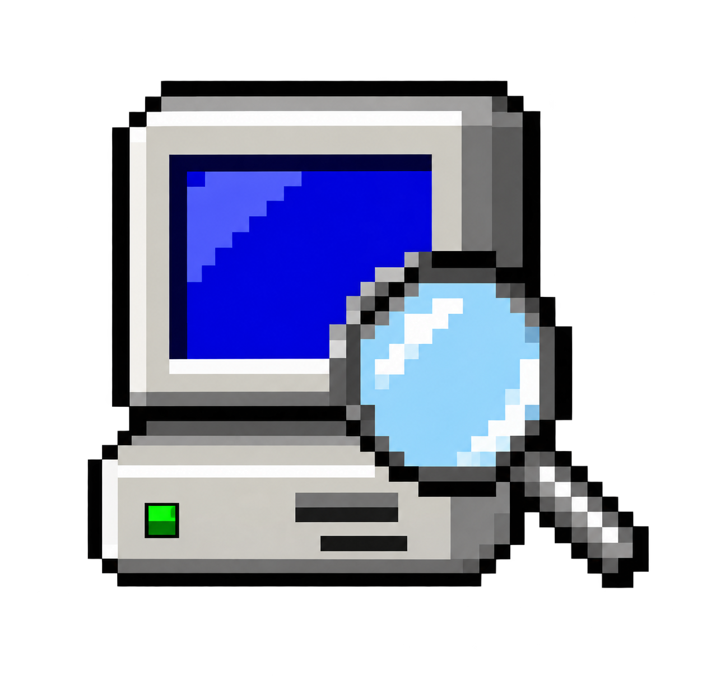

# DeviceScope

A desktop utility for inspecting hardware, drivers, running processes and system
performance. Windows uses C#/.NET Framework with WPF; the Arch and Debian/Pardus
editions use Python with Tk. All six sections open inside one window.

## Download 0.8.0 Beta 1

Download compiled builds from [Releases](https://github.com/hi31922/DeviceScope-/releases).
GitHub's automatic **Source code** archives contain source, not the runnable builds.

| Edition | Download | Run |
| --- | --- | --- |
| Windows 10/11, x64 | [Windows ZIP](https://github.com/hi31922/DeviceScope-/releases/download/v0.8.0-beta.1/DeviceScope-0.8.0-beta.1-windows-x64.zip) | Extract the ZIP and open `DeviceScope-0.8.exe`. |
| Arch Linux, x86-64 | [Portable .run](https://github.com/hi31922/DeviceScope-/releases/download/v0.8.0-beta.1/DeviceScope-0.8.0-linux-x86_64.run) | `sh ./DeviceScope-0.8.0-linux-x86_64.run` |
| Debian / Pardus, amd64 | [Debian package](https://github.com/hi31922/DeviceScope-/releases/download/v0.8.0-beta.1/devicescope_0.8.0-2_amd64.deb) | `sudo apt install ./devicescope_0.8.0-2_amd64.deb`, then `devicescope`. |

Linux builds include Python and Tcl/Tk. They need glibc 2.17 or newer, an X11
desktop or XWayland, and readable desktop fonts. ARM and macOS builds are not
included. Fedora does not have a dedicated release yet.

If you installed a local pre-release with the same Debian package version, use
`sudo apt install --reinstall ./devicescope_0.8.0-2_amd64.deb` to replace it.
Run the installed application as your ordinary desktop user, not with `sudo`.

## Features

- **Devices & Drivers:** inventory, real hardware identifiers, device classification,
  search and filters, JSON snapshot export and comparison.
- **Processes & RAM:** process names and IDs, memory usage, sorting and search, and
  controls to stop a selected process. Stopping a process may lose its unsaved work.
- **Driver Diagnostics:** driver status, declared dependencies and matching device
  events. Linux kernel evidence and Windows Device Manager codes are kept distinct.
- **Live Performance:** CPU and RAM usage, supported GPU readings and temperatures,
  with graphs that leave gaps when readings are unavailable.
- **Disk Health:** disk models, volume usage and supported health/temperature/SMART
  information, with permission and transport limitations shown explicitly.
- **System Specifications:** OS, processor, detected GPUs, installed memory details,
  motherboard, firmware/Secure Boot, storage and display modes. A tab-local button
  copies the complete report, including rows outside the visible area.

Hardware and diagnostic collection is read-only. The process controls act only
when requested. The application needs no web server and includes no telemetry,
driver updater or automatic repair service. Exported snapshots contain hardware
identifiers; review them before attaching them to a public issue.

## Current validation and limitations

This is a **beta release**; bugs and hardware-specific limitations are expected.
Windows was exercised natively on the development
machine, including real system readings and the compact 700 x 580 interface.
The final Linux application packages passed **110 regression tests per edition**
under ordinary users in Arch and Debian WSL. Physical Arch/Pardus hardware and
the school ETAP environment have not been verified with this release.

WSL, virtual machines, firmware permissions, kernel/driver support and USB/RAID
bridges can limit available readings. **Unavailable** is not a measured zero or
proof of a hardware fault. There is no invented universal disk-health percentage,
and the absence of a Linux driver binding alone is not classified as an error.

Linux process stopping needs pidfd support (Linux 5.3+). Optional utilities such
as `smartctl`, `modinfo`, `dmidecode` and `xrandr` improve particular readings;
they are not installed or elevated automatically. See the edition documentation
for details.

## Source layout and building

| Folder | Contents |
| --- | --- |
| [`Windows`](Windows/README.md) | WPF source, icon and `Build.ps1`. |
| [`Arch/source`](Arch/source/README.md) | Arch application source, tests and portable-runtime packager. |
| [`Debian/source`](Debian/source/README.md) | Debian/Pardus source, tests and `.deb` packager. |

On Windows, run this from the repository root in PowerShell:

```powershell
.\Windows\Build.ps1
```

Linux packaging uses Python 3.11+ and the standard library. It downloads a pinned
upstream Linux runtime and checks its SHA-256; the runtime is not executed by a
Windows build host. For example, from `Arch/source`:

```sh
python3 build.py
```

For Debian, run these from `Debian/source`:

```sh
python3 build.py
python3 packaging/build_deb.py dist/DeviceScope-0.8.0-linux-x86_64.run
```

The first runtime download needs internet access. Subsequent builds can use
`python3 build.py --offline` with the verified cached runtime. Compiled binaries,
runtime caches and local backup folders are excluded from Git history.

## Tests and issue reports

The Linux release packages include their regression tests:

```sh
sh ./DeviceScope-0.8.0-linux-x86_64.run --self-test
# Or, after installing the Debian package:
devicescope --self-test
```

The process integration test creates and stops its own disposable workers.
For source tests, run `python3 -m unittest discover -s tests` from the relevant
Linux source directory with Python/Tk installed. GUI tests require a display.

Open a [GitHub issue](https://github.com/hi31922/DeviceScope-/issues) with your
edition/version, OS and kernel or Windows build, steps to reproduce, the expected
result and any error text. Remove serial numbers and other identifiers from
public attachments. Hardware-specific issues are especially useful while native
Linux coverage grows.

## License

DeviceScope application code is licensed under [MIT](LICENSE), copyright 2026
Twoball. Bundled dependencies retain their own licenses; see the
[third-party runtime notices](Arch/THIRD_PARTY.md) and the license files included
with each Linux payload.
